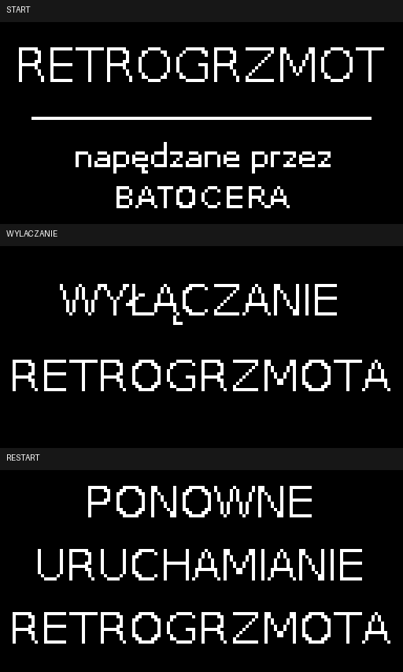

# RETROGRZMOT OLED

An SSD1306 OLED companion display for **Batocera on Raspberry Pi 3B+**, built for the RETROGRZMOT retro console.

The TV runs your games. The small OLED on the case shows what the console is doing.

## What it shows

| When | OLED screen |
| --- | --- |
| Early system startup | RETROGRZMOT / powered by BATOCERA |
| Selecting a console | The selected console's name |
| Browsing its games | The console's name stays on screen |
| Launching a game | RETROGRZMOT, a lightning mark and animated loading dots |
| After the launch animation | The game's title |
| Leaving a game | Back to the console name |
| Shutting down from the Batocera menu | A shutdown message |
| Restarting from the Batocera menu | A restart message |

Long names scroll smoothly in both directions with a pause at each end. Short names stay centered.

**The loading animation lasts three seconds. It is not a measurement of actual loading progress.** A slower game can still be loading when its title appears. No invented percentages are displayed.

Documentation and installer messages are in English. The original OLED labels default to Polish; [English OLED labels are optional](docs/customization.md#choose-the-oled-language).

## Start here — no previous experience needed

Follow these guides in order. They explain where to type each command and what should happen next.

1. [Install Batocera on a microSD card](docs/batocera.md) — skip this if Batocera already works.
2. [Choose the parts and connect the screen](docs/wiring.md).
3. [Install the OLED software from Windows](docs/installation.md).
4. [Change the language or scrolling settings](docs/customization.md) — optional.
5. [Troubleshoot, update or disable the software](docs/troubleshooting.md).

Want to change the code? Read [Editing and testing](docs/development.md). New to GitHub? Read [Using this repository](docs/github-basics.md).

## Tested setup

- Raspberry Pi **3 Model B+**.
- Batocera **42**; Python **3.12.8** with Pillow already present.
- SSD1306 **128×64**, four-pin I²C OLED, powered from **3.3 V**.
- I²C bus **1**, address **0x3C**.

The Polish hardware behavior was tested interactively on this setup: wiring, text, scrolling, game launch/exit, shutdown/restart and earlier startup. Public-package English labels are covered by local rendering tests; they have not yet been checked on the physical screen. Other displays, addresses, boards and Batocera releases are unverified.

This is a small community project, not an official Batocera or Raspberry Pi component. Review the [limitations and update checklist](docs/troubleshooting.md) before changing Batocera versions.

## Deliberate scope

There is no detection of the settings menu and no individual game artwork. Keeping the text readable on a 128×64 display and avoiding a custom EmulationStation build take priority. Those ideas can be revisited for a larger screen.

The early logo appears once Linux can access I²C, not instantly when power is connected. A shutdown message may remain visible while the OLED still receives power; it is not confirmation that power can already be disconnected.

## License

Project code and documentation: [MIT](LICENSE). The bundled DejaVu font has its [own license](retrogrzmot/fonts/LICENSE-DejaVu.txt).

No games, BIOS files, private connection information or personal development logs are included.
