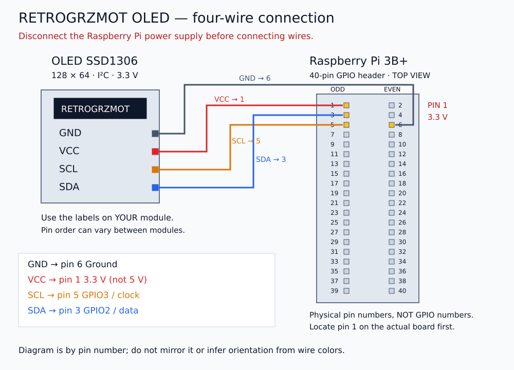

# Parts and wiring

## What you need

- A Raspberry Pi 3B+ running Batocera, a suitable micro-USB power supply and a microSD card.
- An **SSD1306 128×64 I²C OLED module** with four labeled pins: GND, VCC, SCL, SDA. Confirm the module supports a 3.3 V supply.
- Four female-to-female jumper wires if both boards already have male header pins soldered in place.
- A TV/monitor and HDMI cable for initial setup, a controller, and a Windows computer on the same local network.
- A microSD card reader if Batocera is not installed yet.

Bare holes on an OLED board need a soldered header or another proper electrical connection. Pushing loose wires into holes is unreliable. If soldering is new to you, get help with that step before applying power.

## Disconnect power first

Shut down the Raspberry Pi, wait for shutdown to complete, then unplug its power supply. Attach or move wires only while power is disconnected.

We use the **physical pin numbers** on the 40-pin header. These are positions on the connector, not GPIO numbers. For example, physical pin 3 is GPIO2.

## Make these four connections

| OLED label | Raspberry Pi physical pin | Function |
| --- | --- | --- |
| **GND** | **6** | Ground |
| **VCC** | **1** | 3.3 V power |
| **SCL** | **5** | GPIO3 / I²C clock |
| **SDA** | **3** | GPIO2 / I²C data |

The drawing labels the connector by pin number. It does not tell you to rotate the board to match a photograph. Identify **pin 1 on your actual Pi** using the official [GPIO header diagram](https://www.raspberrypi.com/documentation/computers/raspberry-pi.html#gpio). Pin 1 is at the microSD end of the header on the Pi 3B+. The opposite end has pins 39 and 40. Look down onto the components/header, not from underneath the board.

Read the labels printed on your OLED. Similar-looking modules can put their pins in a different order. On the development module the order was GND, VCC, SCL, SDA; its square pad was GND. Do not use pad shape alone to identify an unknown module.

**Do not connect VCC to a 5 V pin for this guide.** The Pi's GPIO signals use 3.3 V logic; a module with pull-ups to 5 V can damage them. If your display needs 5 V or has a different controller/pinout, stop and find its own electrical specifications.

Check every wire against the table. Then connect HDMI and restore power. A black OLED is normal at this stage: it has not been initialized by the software yet.

Continue with [software installation](installation.md).
